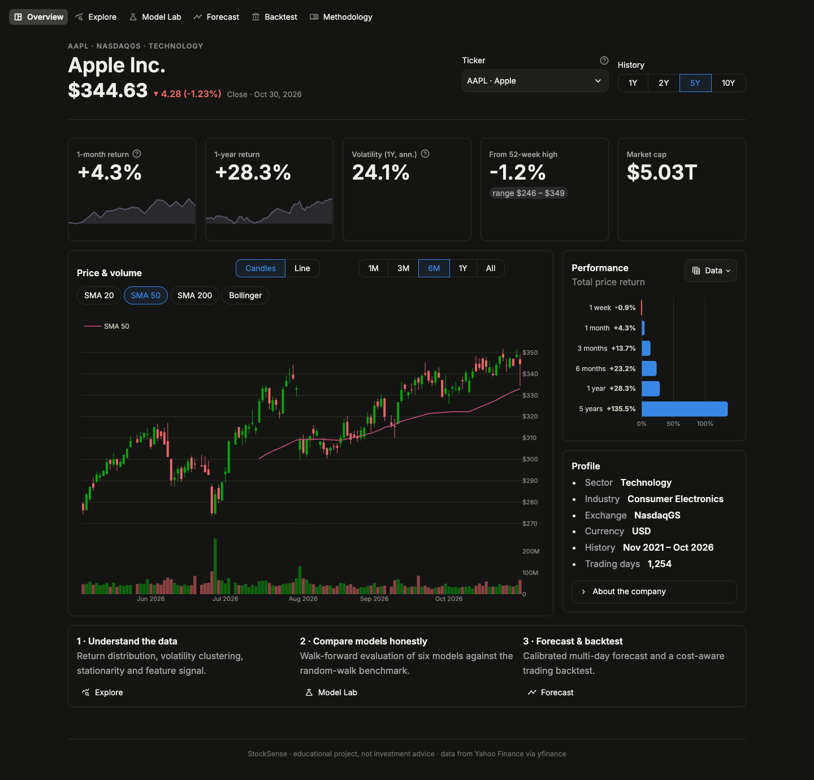
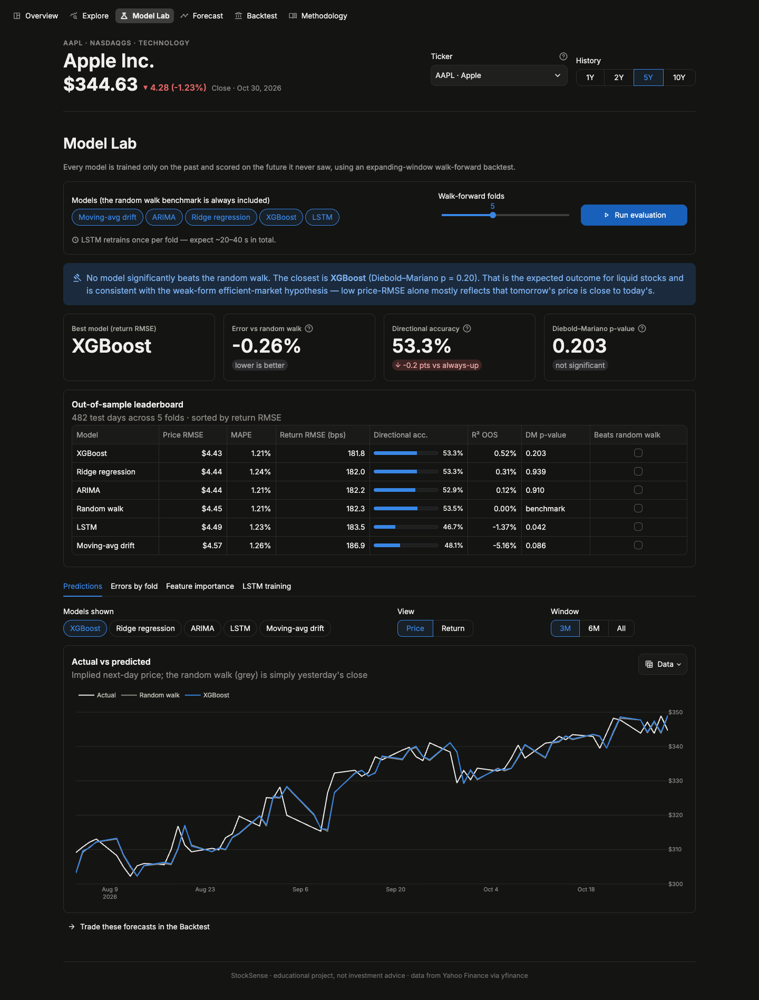
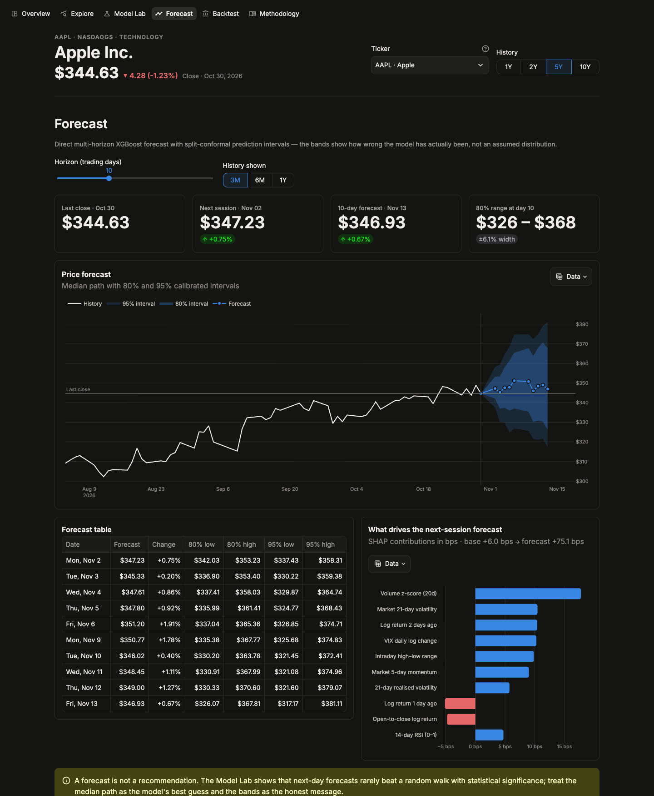
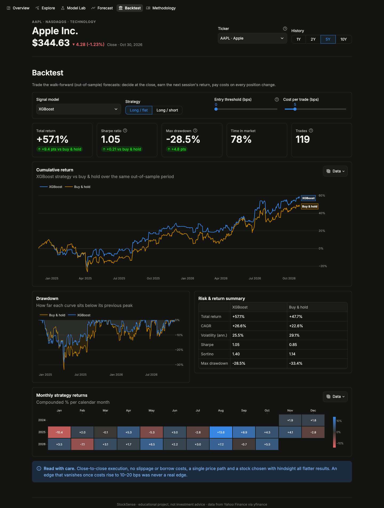
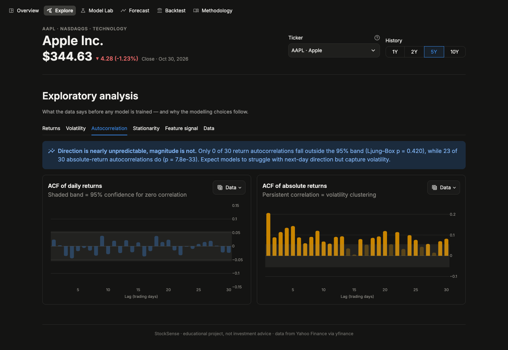

# StockSense — honest, end-to-end stock return forecasting

> Six forecasting models — from a random walk to XGBoost and an LSTM — evaluated with leakage-safe
> walk-forward backtesting, statistical significance tests, a cost-aware trading backtest and
> calibrated multi-day forecasts, all in an interactive Streamlit dashboard.




Most "LSTM stock prediction" projects fit a network to raw prices, score it on a single split and
report a low error, which mostly shows that tomorrow's price is close to today's. StockSense asks
the harder question: **does any model beat a random walk out of sample, and does it make money
after costs?**

| | Typical project | StockSense |
|---|---|---|
| Target | Raw price | Next-day **log return** (stationary — tested with ADF) |
| Evaluation | One 80/20 split | **Walk-forward**, expanding window, 5 folds |
| Benchmark | None | **Random walk** + Diebold–Mariano significance test |
| Leakage | Scaler fit on all data | Scalers fit per fold; **tests prove no look-ahead** |
| Models | One LSTM | Random walk, drift, ARIMA, Ridge, XGBoost, LSTM |
| "Prediction" | Last test-set point | Real **10-day forecast** with conformal intervals |
| Value | Error metrics | **Trading backtest** with costs, Sharpe, drawdown |
| Explainability | — | Exact **TreeSHAP** feature attributions |
| Reproducibility | Notebook | Package + CLI + YAML config + MLflow + pytest |

---

## Results (AAPL, 5 years to 30 Oct 2026)

Out-of-sample walk-forward results over 482 test days (`python -m scripts.train --ticker AAPL`):

| Model | Price RMSE | MAPE | Return RMSE (bps) | Directional acc. | R² OOS | DM p-value |
|---|---|---|---|---|---|---|
| **XGBoost** | $4.43 | 1.21% | 181.8 | 53.3% | +0.52% | 0.203 |
| Ridge regression | $4.44 | 1.24% | 182.0 | 53.3% | +0.31% | 0.939 |
| ARIMA(1,0,1) | $4.44 | 1.21% | 182.2 | 52.9% | +0.12% | 0.910 |
| Random walk (benchmark) | $4.45 | 1.21% | 182.3 | 53.5%* | 0.00% | — |
| LSTM | $4.49 | 1.23% | 183.5 | 46.7% | −1.37% | 0.042† |
| Moving-avg drift | $4.57 | 1.26% | 186.9 | 48.1% | −5.16% | 0.086 |

\* Always predicting "up" scores the up-day base rate. † Significantly *worse* than the random walk.

**What this means**

- **No model significantly beats the random walk** (all DM p > 0.05). That is the expected result
  for a heavily traded stock and is consistent with the weak-form efficient-market hypothesis.
- **A ~1.2% MAPE is not an achievement.** The random walk scores the same, which is why
  price-error metrics alone are misleading.
- **The LSTM is the worst learned model.** It overfits the noise; a regularised linear model and
  shallow boosted trees generalise better on weak signals.
- The **XGBoost long/flat strategy** returned **+57.1% vs +47.7%** for buy & hold over the same
  period (Sharpe 1.05 vs 0.85, max drawdown −28.5% vs −33.4%) after 5 bps costs. Because the
  forecast edge is not statistically significant, treat this as a hypothesis to test on other
  tickers, not as proof of an edge.

Results change with the ticker, period and run date; the app recomputes everything live.

---

## The dashboard

| Page | What it shows |
|---|---|
| **Overview** | Candlestick + volume with SMA/Bollinger overlays, KPIs, period returns, company profile |
| **Explore** | Return distribution vs normal and Q–Q plot, volatility regimes and VIX, ACF of returns vs \|returns\|, ADF stationarity tests, feature information coefficients, correlation matrix, raw data download |
| **Model Lab** | Walk-forward fold diagram, leaderboard with significance tests, actual vs predicted (price or return view), per-fold improvement over the random walk, SHAP feature importance, LSTM learning curves |
| **Forecast** | 5–20-day fan chart with 80%/95% conformal intervals, forecast table, SHAP drivers of the next-session forecast |
| **Backtest** | Strategy vs buy & hold equity curve, drawdowns, risk/return table, monthly returns heatmap; adjustable model, long/short, threshold and costs |
| **Methodology** | Pipeline diagram, leakage controls, evaluation design, limitations |

Every chart has a **Data** button that shows the underlying numbers as a table.

| Model Lab | Forecast |
|---|---|
|  |  |
| **Backtest** | **Explore** |
|  |  |

---

## Quick start

**Prerequisites:** Python 3.10–3.12 (tested on 3.12; TensorFlow wheels may lag newer Pythons). On macOS, XGBoost
also needs OpenMP: `brew install libomp`.

```bash
git clone git@github.com:Guru-Prasaath/Stock-Price-Prediction-1.git
cd Stock-Price-Prediction-1

python3.12 -m venv venv
source venv/bin/activate
pip install -r requirements-dev.txt     # or requirements.txt for the app only

streamlit run app.py                    # → http://localhost:8501
```

Pick a ticker (or type any Yahoo Finance symbol, such as `RELIANCE.NS` or `BMW.DE`) and a history
length in the header, then open **Model Lab → Run evaluation**. Forecast and Backtest build on
those results.

### Command line

```bash
# Full pipeline: walk-forward evaluation → backtest → forecast → saved artifacts
python -m scripts.train --ticker AAPL

# Pick models / history, and log the run to MLflow
python -m scripts.train --ticker MSFT --years 8 --models ridge xgboost --track
mlflow ui --backend-store-uri sqlite:///mlflow.db       # browse experiments

pytest                                                  # 34 tests, ~5 s, no network needed
```

Each CLI run writes `artifacts/<TICKER>/<timestamp>/` with the config, leaderboard, out-of-sample
predictions, per-fold scores, forecast, backtest and the refitted models (XGBoost JSON, Keras,
joblib), plus metadata (git SHA, versions).

### Notebook

[`notebooks/01_eda.ipynb`](notebooks/01_eda.ipynb) is the written exploratory analysis. Each
finding is tied to the modelling decision it motivates. Regenerate and execute it with:

```bash
python notebooks/build_eda_notebook.py
jupyter nbconvert --to notebook --execute --inplace notebooks/01_eda.ipynb
```

---

## Project structure

```
├── app.py                    # Streamlit entry: top navigation + global ticker/period header
├── app_pages/                # Overview · Explore · Model Lab · Forecast · Backtest · Methodology
├── ui/                       # Design tokens, chart builders, cached state, components
├── stocksense/               # The data-science package (no Streamlit dependency)
│   ├── config.py             #   typed config loaded from configs/default.yaml
│   ├── data.py               #   yfinance download + Parquet cache, market/VIX context
│   ├── features.py           #   23 leakage-safe features + next-day target
│   ├── models/               #   common Forecaster interface
│   │   ├── baselines.py      #     random walk, drift, Ridge, ARIMA
│   │   ├── gbm.py            #     XGBoost + TreeSHAP
│   │   └── lstm.py           #     stacked LSTM over feature windows
│   ├── evaluation.py         #   walk-forward splits, leaderboard, verdict
│   ├── metrics.py            #   RMSE/MAPE/R²oos, Diebold–Mariano, binomial direction test
│   ├── backtest.py           #   cost-aware long/flat & long/short backtest
│   ├── forecast.py           #   direct multi-horizon forecast + conformal intervals
│   ├── pipeline.py           #   orchestration shared by app and CLI
│   └── tracking.py           #   run artifacts + MLflow logging
├── scripts/train.py          # CLI
├── configs/default.yaml      # All hyperparameters in one place
├── notebooks/                # EDA notebook (+ its generator)
├── tests/                    # Leakage, model-contract, metric, backtest and forecast tests
└── .streamlit/config.toml    # Theme
```

---

## Methodology

**1. Data.** Daily split- and dividend-adjusted OHLCV from Yahoo Finance, plus SPY (market) and
^VIX (volatility regime) as context. Downloads are cached as Parquet.

**2. Target.** Next-day log return `r[t+1] = ln(C[t+1] / C[t])`. Prices fail the ADF stationarity
test and returns pass it. A return forecast converts to a price as `Ĉ[t+1] = C[t]·exp(r̂)`.

**3. Features (23).** Lagged returns, 5- and 21-day momentum, 10- and 21-day realised volatility,
RSI-14, MACD line and histogram, Bollinger %B, distance from the 10- and 50-day SMAs, intraday
range, open-to-close return, volume z-score, market return, momentum and volatility, VIX level and
change. Each value uses only data available at that day's close.

**4. Leakage controls.**
- The feature test rebuilds features on truncated history and asserts past values are identical.
- The model-contract test perturbs future rows and asserts past predictions don't change, for
  every model.
- Scalers live inside each fold's training step.

**5. Walk-forward evaluation.** The first 60% of history trains fold 1. Each of the 5 folds
retrains on all data before its contiguous test block.

**6. Metrics.**
- Price RMSE and MAPE, which are intuitive but flattering.
- Return RMSE, used for ranking.
- Directional accuracy.
- Campbell–Thompson out-of-sample R² against the zero forecast.

**7. Significance tests.**
- Diebold–Mariano test with the Harvey–Leybourne–Newbold correction, comparing squared errors
  against the random walk.
- One-sided binomial test of directional accuracy against the majority-class rate.

**8. Backtest.** The position is set at the close of day *t* and earns the return of *t+1*. Costs
are charged on turnover, and results are compared with buy & hold over the same days.

**9. Forecast.** The direct strategy fits one XGBoost model per horizon *h*. Split-conformal
intervals come from that horizon's residual quantiles on the most recent 20% of history. Fat tails
make Gaussian intervals too narrow, which is why empirical quantiles are used.

**10. Explainability.** Exact TreeSHAP values break the next-session forecast down into
per-feature contributions.

---

## Viva questions & answers

**1. Why predict returns instead of prices?**
Prices are non-stationary: their mean and variance drift, and the ADF test can't reject a unit
root. A model trained on old price levels extrapolates badly and learns to copy yesterday's
price. Log returns are stationary and additive over time, and they convert back to prices exactly.

**2. What is data leakage, and where could it happen here?**
Leakage is when information from the future reaches training. Typical sources are:
- Fitting a scaler on the full dataset, which the original version of this project did.
- Back-filling missing values from future rows.
- Shuffling before a train/test split.
- Computing a feature with a centred rolling window.

StockSense fits scalers per fold and forward-fills only. Automated tests check both the features
and every model's predictions for look-ahead.

**3. Why walk-forward validation instead of k-fold cross-validation?**
K-fold mixes past and future, so a model can train on 2025 data and be tested on 2023. Walk-forward
always tests on data after the training window, which simulates live use. Using several folds
also shows whether performance is stable across market regimes.

**4. What is the random walk benchmark, and why does it matter?**
It predicts zero return: tomorrow's price equals today's. It already achieves about 1.2% MAPE on
AAPL, so a model with 1.2% MAPE has learned nothing extra. A model is only useful if it beats this
benchmark.

**5. What does the Diebold–Mariano test do?**
It tests whether two forecasts have equal expected loss. It compares the model's squared errors
with the random walk's, day by day, and adjusts for autocorrelation (with a small-sample
correction). A negative statistic with p < 0.05 means the model is significantly more accurate.

**6. Why did the LSTM perform worst?**
The signal is weak (|IC| below 0.05) and the dataset is small, about 1,000 training samples per
fold. A high-capacity network fits noise. Regularised linear models and shallow boosted trees have
lower variance and generalise better. More complex is not automatically better.

**7. What is out-of-sample R², and why is it so close to zero?**
It is `1 − SSE_model / SSE_zero`, the share of the zero forecast's squared error that the model
removes. For daily stock returns, values of 0–1% are normal; even a small positive value can be
economically meaningful if it is stable.

**8. How are the forecast intervals built?**
They use split-conformal prediction. Each horizon's model is trained on the first 80% of history
and its errors are measured on the last 20%. The empirical 10th/90th (and 2.5th/97.5th)
percentiles of those errors set the 80% (95%) band. No normality assumption is needed, which
matters because returns are fat-tailed (excess kurtosis about 5.7 for AAPL).

**9. Why can a strategy make money if the forecast isn't significantly better?**
Trading P&L depends on getting large moves right, not on squared error. Over one 2-year path,
luck can't be ruled out either. That's why the app shows the significance test next to the
backtest and lets you raise costs. An edge that disappears at 10–20 bps of cost was never real.

**10. What do the SHAP values show?**
TreeSHAP breaks each XGBoost prediction exactly into a base value plus one contribution per
feature, and the contributions sum to the prediction (this is a unit test). The mean absolute
SHAP value ranks features globally; per-row values explain a specific forecast.

**11. What does early stopping do in the XGBoost and LSTM models?**
It holds out the most recent part of each training window and stops adding trees (or epochs) when
validation loss stops improving, keeping the best iteration. This controls overfitting without
looking at the test fold.

**12. What are the main limitations?**
- Daily bars only: no news, fundamentals or intraday data.
- One price path per ticker.
- Close-to-close execution, with no slippage or borrow costs.
- Survivorship and selection bias in which tickers people test.

---

## Limitations & disclaimer

This is an **educational project and not investment advice**. Results depend on the ticker,
period and costs. Markets change, and past out-of-sample performance does not guarantee future
results.

## License

MIT — free to use and modify.
